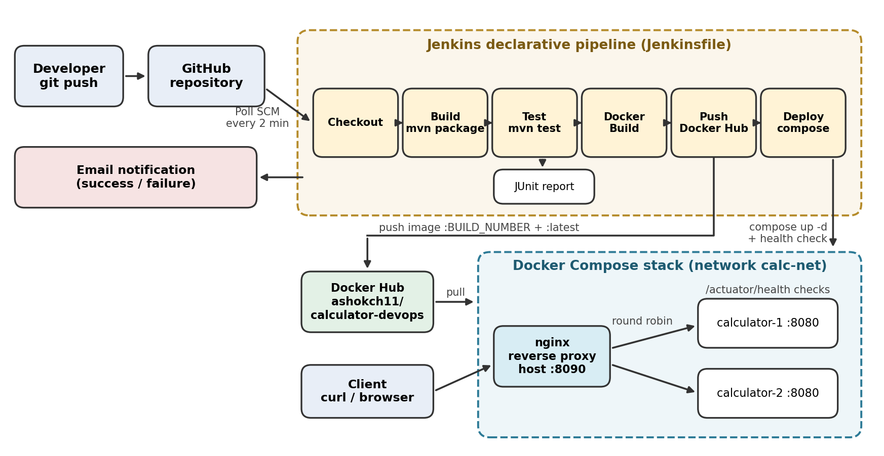
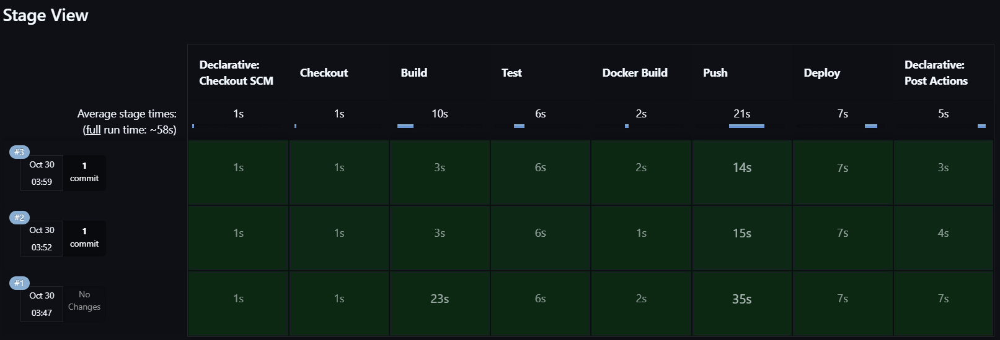
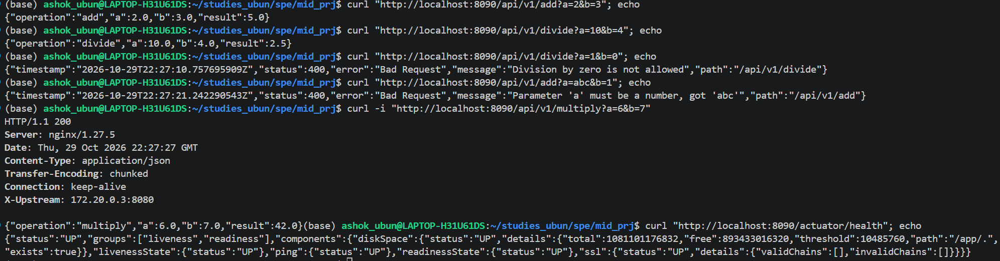
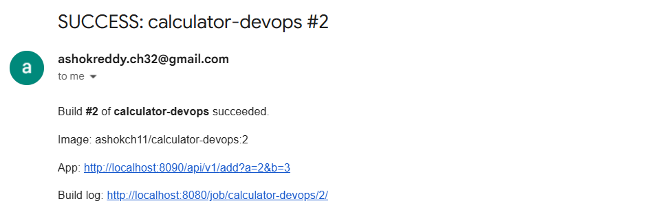

\begin{center}
{\Large\bfseries CI/CD Pipeline for a Calculator REST API}\\[3pt]
Ashok Reddy (IMT2023083) \quad · \quad 30 October 2026
\end{center}

**GitHub:** <https://github.com/ashokCh-dev/calculator-devops>  
**Docker Hub:** <https://hub.docker.com/r/ashokch11/calculator-devops>

# 1. Overview

The application is a Calculator REST API written in Java 21 with Spring Boot 3.5 (Spring Web,
Validation and Actuator). Every push to GitHub runs through an automated Jenkins pipeline that
builds and tests the code, packages it as a Docker image, pushes the image to Docker Hub and deploys
it with Docker Compose. No manual steps are needed, and Jenkins emails the result of every build.

| Endpoint | Behaviour |
|---|-----|
| `GET /api/v1/add?a=&b=` | Returns `a + b`, e.g. `{"operation":"add","a":2.0,"b":3.0,"result":5.0}` |
| `/subtract`, `/multiply`, `/divide` | Returns `a - b`, `a * b`, `a / b` in the same JSON format |
| Errors | Division by zero, a missing parameter or a non-numeric value returns HTTP 400 with `timestamp, status, error, message, path` |
| `GET /actuator/health` | Spring Actuator health probe (`UP`/`DOWN`), used by the Docker and Compose health checks |

Errors are handled in one place by a `@RestControllerAdvice`. The code has **28 tests**: 20
parameterised JUnit 5 unit tests for `CalculatorService` (positive, negative and decimal inputs, and
divide by zero) and 8 MockMvc integration tests that call the real endpoints, including every error
case and the health endpoint. JaCoCo produces a coverage report.

{ width=82% }

# 2. Pipeline Stages (Jenkinsfile)

| Stage | What it does |
|--|----------|
| **Trigger** | `pollSCM('H/2 * * * *')`: starts a build when GitHub has a new commit. |
| **Checkout** | `checkout scm` gets the commit that triggered the build. |
| **Build** | `./mvnw clean package -DskipTests` (Maven wrapper, so no Maven install is needed). |
| **Test** | `./mvnw test`: runs all 28 tests; results published with `junit`; a failure fails the build. |
| **Docker Build** | Builds the image tagged `:<BUILD_NUMBER>` and `:latest`. |
| **Push** | Logs in to Docker Hub with the Jenkins credential `dockerhub-creds` and pushes both tags. |
| **Deploy** | `docker compose up -d`, then waits for `/actuator/health` = `UP` through Nginx and runs a smoke test. If the stack is not healthy within about 90 s, the stage fails and prints the container logs. |
| **Post** | `emailext` sends a success or failure email (the failure email has the log attached); dangling images are pruned. |

The pipeline uses `timestamps()`, `disableConcurrentBuilds()` (two builds never deploy at the same
time), log rotation and a 30-minute timeout. The Docker Hub token and the Gmail app password live only
in the Jenkins credentials store, never in the repository. Re-running the pipeline is safe: the
Compose project name is fixed and `docker compose up -d` only recreates containers whose image
changed, so a working deployment is never taken down first.

# 3. Containerisation and Deployment

**Dockerfile (multi-stage).** Stage 1 (`maven:3.9.11-eclipse-temurin-21`) copies `pom.xml` and
downloads dependencies before copying the source, so the dependency layer is cached between builds.
Stage 2 (`eclipse-temurin:21-jre-alpine`) contains only the JRE and the JAR. It runs as the non-root
user `spring` and declares `EXPOSE 8080` and a `HEALTHCHECK`. A `.dockerignore` keeps `target/`,
`.git` and docs out of the build context. The image runs with a single
`docker run -p 8085:8080 ashokch11/calculator-devops`.

**Docker Compose.** `docker-compose.yml` starts three containers on the bridge network `calc-net`:
two API replicas (`calculator-1`, `calculator-2`), each with a health check on `/actuator/health`,
`restart: unless-stopped` and environment variables (`SERVER_PORT`, `INSTANCE_NAME`, `JAVA_OPTS`), and
an **Nginx reverse proxy** on host port 8090 that load-balances them with round robin. Nginx starts
only after both replicas are healthy, and adds an `X-Upstream` header showing which replica answered.

# 4. Version Control

The history is built from small, progressive commits. The Compose deployment and the Jenkins
pipeline were each developed on a feature branch (`feature/docker-compose`,
`feature/jenkins-pipeline`), opened as a pull request and merged into `main`. The `.gitignore`
covers `target/`, IDE files, `.env` and key files, and no secrets are committed.

# 5. Challenges Faced

1. **Port clash:** Jenkins already uses port 8080. The app keeps 8080 inside its containers, and
   only the Nginx proxy is published to the host, on port 8090, so all traffic goes through the proxy.
2. **Load balancing:** at first every request reached the same replica, because each Nginx worker
   process kept its own round-robin counter. Adding a shared `zone` to the `upstream` block gave all
   workers one shared state, and requests now alternate between the replicas.
3. **Maven on the Jenkins agent:** the `jenkins` user had no Maven installed. Committing the Maven
   wrapper (`mvnw`) made every environment use the same Maven 3.9.11.
4. **Health checks in a minimal image:** the Alpine JRE image has no `curl`, so the Dockerfile and
   Compose health checks use BusyBox `wget` and check for `"status":"UP"`.
5. **Email notifications:** the first notification went to a different address from the Gmail
   account used for SMTP. Setting the address in the Jenkinsfile to the same account fixed it, and
   Gmail requires an app password rather than the normal account password.

\newpage

# 6. Results

All stages pass on every push. Builds #3 to #8 were started automatically by Poll SCM
("Started by an SCM change") with no manual step. The image is on Docker Hub and the stack is healthy.

{ width=100% }

{ width=100% }

{ width=100% }

\newpage

{ width=62% }

{ width=100% }

{ width=78% }

{ width=100% }
