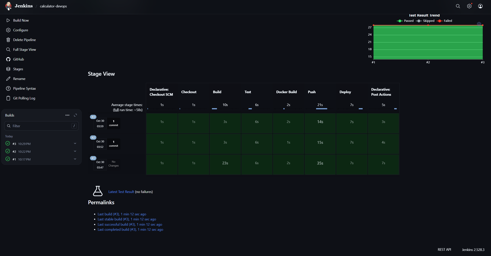
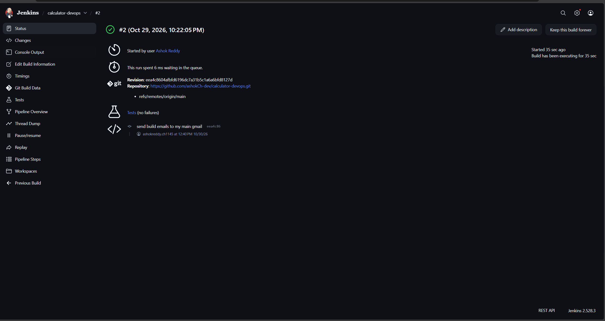
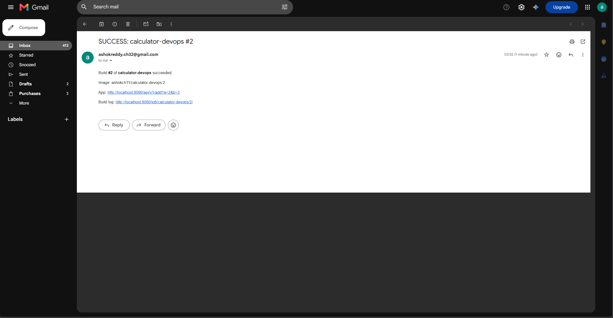
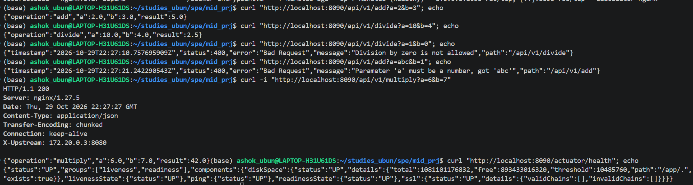

**GitHub:** <https://github.com/ashokCh-dev/calculator-devops>  
**Docker Hub:** <https://hub.docker.com/r/ashokch11/calculator-devops>

# 1. Overview

The project is a Calculator REST API written in Java 21 with Spring Boot 3.5. A commit pushed to
GitHub goes through an automated pipeline that builds it, tests it, packages it into a Docker
image, pushes the image to Docker Hub, and deploys it with Docker Compose. No step is manual.
Jenkins emails the result of every run.

The API exposes `GET /api/v1/{add,subtract,multiply,divide}?a=&b=` and returns JSON such as
`{"operation":"add","a":2.0,"b":3.0,"result":5.0}`. Division by zero, a missing parameter, or a
non-numeric value returns HTTP 400 with a structured error body
(`timestamp, status, error, message, path`). This is handled in one place by a
`@RestControllerAdvice`. Spring Boot Actuator provides `/actuator/health`, which Docker and
Compose use as the health check.

# 2. Pipeline Architecture

{ width=92% }

# 3. Pipeline Stages

The pipeline is a declarative `Jenkinsfile` kept in the repository. The global options are
`timestamps()`, `disableConcurrentBuilds()` (two builds never deploy at the same time), a
build-log rotation, and a 30-minute timeout.

| Stage | Description |
|--|----------|
| **Trigger** | `pollSCM('H/2 * * * *')` checks GitHub about every 2 minutes and starts a build when there is a new commit. |
| **Checkout** | `checkout scm` gets the exact commit that triggered the build. |
| **Build** | `./mvnw -B clean package -DskipTests` compiles the code and creates `calculator.jar`. The Maven wrapper pins the Maven version, so the Jenkins agent needs no Maven installation. |
| **Test** | `./mvnw -B test` runs 28 tests: 20 parameterised JUnit 5 unit tests for every operation and the divide-by-zero case, plus 8 MockMvc integration tests against the real endpoints, including the error cases and `/actuator/health`. `junit 'target/surefire-reports/*.xml'` publishes the results, and a failing test fails the build. JaCoCo also writes a coverage report. |
| **Docker Build** | `docker build` builds the image with two tags: `ashokch11/calculator-devops:<BUILD_NUMBER>` and `:latest`. |
| **Push** | `withCredentials` reads the Docker Hub username and token from the Jenkins credentials store (`dockerhub-creds`). It logs in with `--password-stdin`, pushes both tags, then logs out. No secret is ever stored in the repository. |
| **Deploy** | `docker compose up -d --remove-orphans` with `IMAGE_TAG=<BUILD_NUMBER>`. The stage then polls `http://localhost:8090/actuator/health` through Nginx until it returns `UP`, and runs a smoke test on `/api/v1/add`. If the stack is not healthy within about 90 s, the stage fails and prints the container logs. |
| **Post** | `emailext` sends a success or failure email to the student's address (the failure email has the build log attached). `docker image prune -f` removes dangling layers. |

**Idempotency.** The Compose project name is fixed (`name: calculator`), and `docker compose up -d`
only recreates containers whose configuration or image tag changed. The pipeline never runs
`down` first. A re-run therefore either does nothing or does a quick replace, and a working
deployment is never removed before the new one is up.

# 4. Containerisation and Deployment

**Dockerfile (multi-stage).** Stage 1 (`maven:3.9.11-eclipse-temurin-21`) copies `pom.xml` and
runs `dependency:go-offline` before it copies the source. Dependencies are therefore cached in their
own layer and are only downloaded again when the pom changes. Stage 2
(`eclipse-temurin:21-jre-alpine`) holds only the JRE and the jar. It runs as the non-root user
`spring`, declares `EXPOSE 8080` and a `HEALTHCHECK` against `/actuator/health`, and reads
`JAVA_OPTS` from the environment. A `.dockerignore` keeps `target/`, `.git`, documentation, and
IDE files out of the build context. The image runs with a single
`docker run -p 8085:8080 ashokch11/calculator-devops`.

**Docker Compose.** `docker-compose.yml` starts three services on a bridge network called `calc-net`:

* `calculator-1` and `calculator-2`: two replicas of the API. Each has a health check on
  `/actuator/health`, the restart policy `unless-stopped`, and environment variables
  (`SERVER_PORT`, `INSTANCE_NAME`, `JAVA_OPTS`). A YAML anchor shares their common settings.
* `nginx` (1.27-alpine): a reverse proxy published on host port 8090. It load-balances the two
  replicas with round robin. It starts only when both replicas report `service_healthy`, and it
  has its own health check. Each response carries an `X-Upstream` header that shows which replica
  served it.

# 5. Version Control Practices

The repository has a Java/Maven `.gitignore` covering `target/`, IDE files, `.env`, and key
files. The history is built up over many small commits. The Compose deployment and the Jenkins
pipeline were each developed on a feature branch (`feature/docker-compose` and
`feature/jenkins-pipeline`), opened as a pull request, and merged into `main` with a merge commit.
Credentials exist only in Jenkins.

# 6. Challenges Faced

1. **Webhook not reachable.** Jenkins runs locally (WSL) on `localhost:8080`, so GitHub cannot
   deliver a webhook to it. I used the Poll SCM trigger, which the problem statement allows, with
   a 2-minute interval and `H` hashing so polling load is spread out.
2. **Port clash.** Jenkins already uses port 8080. The application keeps 8080 inside its
   containers, and only the Nginx proxy is published to the host, on port 8090. The replicas are
   not published, so all traffic goes through the proxy.
3. **Load balancing looked broken.** At first every request reached the same replica. Nginx keeps
   round-robin state separately in each worker process, and each new curl connection could land
   on a worker whose counter had not moved. Adding a shared `zone` to the `upstream` block gives
   all workers one round-robin state. After that, requests alternate between `calculator-1` and
   `calculator-2`.
4. **Different Maven versions.** On this machine Maven is a Windows install used from WSL, and the
   `jenkins` user has no Maven at all. Committing the Maven wrapper (`mvnw`) makes every
   environment use the same Maven 3.9.11.
5. **Health checks in a minimal image.** The Alpine JRE image has no `curl`. The Dockerfile and
   Compose health checks therefore use BusyBox `wget` and look for `"status":"UP"` in the response.
6. **Redeploying safely.** A naive `docker compose down && up` causes downtime and fails if a
   container name is already in use. A fixed project name with `up -d` makes re-runs safe. The
   pipeline also waits for a real `UP` from the proxy before it reports success.

# 7. Results

All six stages pass. The pipeline publishes the JUnit results (28 tests passing), pushes the image
to Docker Hub, and deploys the stack. `docker ps` shows `calculator-1`, `calculator-2`, and
`calculator-nginx` as *healthy*. The screenshots in the appendix (stage view, build page, notification email,
`docker ps`, sample API responses) are also in `docs/screenshots/`. For the live demo, a code change is
pushed to GitHub and the pipeline deploys it automatically.

\newpage

# Appendix: Screenshots

{ width=100% }

{ width=100% }

{ width=100% }

{ width=100% }

{ width=100% }
